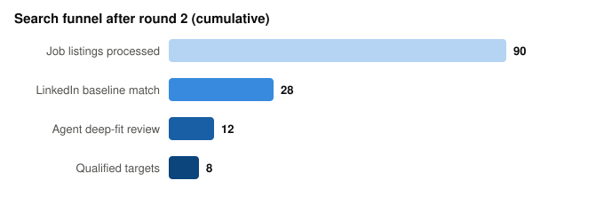
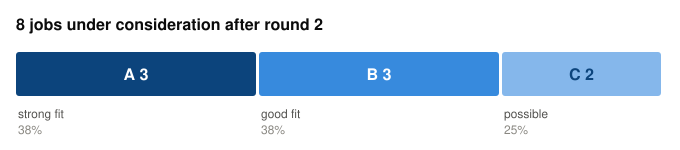

# Saved jobs re-screen - round 2 (2026-11-14)

11 saved jobs, each read in full (3 new this round; the rest keep their earlier review). Calibration questions at the end may still adjust scores.

**Score** = fit from the full-text review (0-100) + adjustments from confirmed rules (domain 60/40, travel sliding scale, ...) + 8 for a 1st-degree connection. The breakdown is shown as fit / adjustments / network.

## Search funnel: progress through the sea of jobs

Each job is counted once per stage (by company + title), so a job that reappears in later searches isn't counted again. 'Job listings processed' includes cards ruled out automatically; 'LinkedIn baseline match' is your triage call on LinkedIn's match; 'Agent deep-fit review' is every saved PDF the agent read in full; 'Qualified targets' are the jobs on the ranked list. Recorded at the end of each round by `engine/metrics.py --round N`.

| Round | Job listings processed | LinkedIn baseline match (keep / maybe / DQ) | Agent deep-fit review (from triage + direct) | Qualified targets at round end |
|---|---|---|---|---|
| 1 | 44 | 20 (8 / 0 / 12) | 9 | 6 |
| 2 | 46 | 8 (3 / 0 / 5) | 3 | 8 |
| **Total** | **90** | **28** | **12** | **8** (now) |

Conversion so far: 31% of job listings processed reached a LinkedIn baseline match (your triage call); the agent's deep-fit review covered 43% as many jobs as that stage (it also takes alert and direct saves); 67% of deep-fit reviews are qualified targets now. Out of 90 job listings, 8 are qualified targets (9%).

### Triage mode

**Catch-up progress:** Goal: 200 listings. Processed: 90 (45%). Left: 110. At the last 14 days' pace (90 a day), about 2026-11-19. Backlog not yet captured: 66 listings LinkedIn reported beyond what the latest runs captured; no result count recorded for S2, S3. Lookback: each search’s own window. Pace plan: two sessions a week, about an hour each.

Mode: **catch-up**

| Round | Mode | Listings processed | New criteria rules | Rules per 100 | Already decided | Keeps per 100 cards | Agent calls (firm agree / hedged) |
|---|---|---|---|---|---|---|---|
| 1 | catch-up | 44 | 5 | 11.4 | 0% | 40 | – |
| 2 | catch-up | 46 | 2 | 4.3 | 0% | 38 | 5/7 (71%) / 1 of 8 |

Volume: not met (90 listings in the last 14 days; 90 in all, goal 200).
Stability: 0 of 4 (need 2): rules per 100 under 1 (two rounds) no; agreement 90%+ with few hedges no; 70%+ already decided no; steady keep rate no.
No switch prompt: the signals aren't there yet.

## Applications: from qualified target to offer

Picks up where the search funnel ends. A job counts at every stage it has reached; a rejection after applying counts as a response. What to do next for each job is in [apply-queue.md](apply-queue.md).

| Stage | Jobs | Of the stage before |
|---|---|---|
| Qualified targets | 8 |  |
| Kit built | 2 | 25% |
| Applied | 2 | 100% |
| Employer response | 1 | 50% |
| Interview | 1 | 100% |
| Offer | 0 | 0% |

## Ranked list

| # | Score | Tier | Role | Company | Where | Pay (as posted) | 1st-degree |
|---|---|---|---|---|---|---|---|
| 1 | 90 (80 +2 +8 net) | A | [Senior Product Manager, Shipment Visibility](https://example.com/jobs/9100000001) | Harborline Logistics | Remote - United States (Remote) | $155K-$185K | Sam Ortiz (fictional) |
| 2 | 88 (82 +6) | A | [Staff Product Manager, Carrier Integrations API](https://example.com/jobs/9100000002) | Cobalt Route | Remote - Denver, CO (Remote) | $170K-$200K |  |
| 3 | 86 (80 +6) | A | [Senior Product Manager, Fleet Platform APIs](https://example.com/jobs/9100000009) | Arcadia Fleet | Remote - United States (Remote) | $165K-$195K |  |
| 4 | 76 | B | [Senior Product Manager, Freight Marketplace](../3-applications/northwind-freight-sr-pm-marketplace/job-description.txt) | Northwind Freight (through Summit Staffing) | Hybrid - Springfield, IL (~0 mi) | not stated (ask the recruiter) | external · interviewing |
| 5 | 70 | B | [Senior Product Manager, Inventory Planning](https://example.com/jobs/9100000008) | Pinecrest Health Supply | Remote - United States (Remote) | $145K-$170K |  |
| 6 | 68 (74 -6) | B | [Principal Product Manager, Warehouse Automation](https://example.com/jobs/9100000003) | Brightdock | Hybrid - Decatur, IL (Hybrid) (~37 mi) | $150K-$175K |  |
| 7 | 54 (62 -8) | C | [Senior Product Manager, Checkout and Delivery Options](https://example.com/jobs/9100000006) | Lumen Cart | Remote - United States (Remote) | $160K-$190K |  |
| 8 | 52 (60 -8) | C | [Product Manager, Logistics Data Platform](https://example.com/jobs/9100000005) | Tessellate Systems | Remote - United States (Remote) | not listed |  |
| 9 | 70 | X | [Senior Product Manager, Returns](https://example.com/jobs/9100000004) | Meridian Parcel | Hybrid - Chicago, IL (Hybrid) (~179 mi) | $140K-$165K |  |
| 10 | 66 | X | [Group Product Manager, Supply Chain Planning](https://example.com/jobs/9100000010) | Quillstone Software | Remote - United States (Remote) | $190K-$220K |  |
| 11 | - | X | [Product Manager, Logistics Software](https://example.com/jobs/9100000007) | Ironbridge Defense Systems | Remote - United States (Remote) | not listed |  |

## Your 1st-degree connections at these companies

- **Sam Ortiz (fictional)** (Director of Engineering at Harborline Logistics) - Harborline Logistics, *Senior Product Manager, Shipment Visibility*

## Job-by-job: looks good, but...

### A - strong fit

#### Harborline Logistics - Senior Product Manager, Shipment Visibility (90)

Shipment-visibility platform: the candidate's core domain, including ETA prediction with data science.

*Adjustments:* core domain (+6); travel 10% (-4)

**Looks good:** Core domain: tracking, ETA and exception alerts / APIs and webhooks match the carrier-integration program / 1st-degree connection (fictional)

**But:** Travel up to 10%

*Skill gaps:* Machine-learning product depth (nice to have; partial)

[Posting](https://example.com/jobs/9100000001)

#### Cobalt Route - Staff Product Manager, Carrier Integrations API (88)

Public carrier API and certification program at a carrier network; a near-exact match for the carrier-integration program.

*Adjustments:* core domain (+6)

**Looks good:** Carrier API, SDKs and certification: done before at scale / API pricing and packaging (nice to have) is a strength

**But:** Staff level: ask about scope and how the role is leveled

[Posting](https://example.com/jobs/9100000002)

#### Arcadia Fleet - Senior Product Manager, Fleet Platform APIs (86)

Partner APIs and a carrier certification program on a fleet platform; a strong keep in triage, confirmed in calibration.

*Adjustments:* core domain (+6)

**Looks good:** Carrier certification program: done before for 1,400 carriers / Usage-based pricing (nice to have) is a strength

**But:** Telematics devices are new territory

*Skill gaps:* Telematics or IoT devices (nice to have; missing)

[Posting](https://example.com/jobs/9100000009)

### B - good fit

#### Northwind Freight (through Summit Staffing) - Senior Product Manager, Freight Marketplace (76)

Freight marketplace for regional shippers and small carriers; hybrid in Springfield; through a staffing firm.

**Looks good:** Carrier onboarding and partner networks / Pricing backed by data / Local hybrid

**But:** Through a staffing firm: contract or conversion not stated

*Skill gaps:* Two-sided marketplace (required; partial), Payments or factoring (nice to have; missing)

[Posting](../3-applications/northwind-freight-sr-pm-marketplace/job-description.txt)

#### Pinecrest Health Supply - Senior Product Manager, Inventory Planning (70)

Demand forecasting and replenishment for a medical supply distributor.

**Eligibility / regulated requirements (beyond your baseline in spec.json):** background check and drug screening (person): "This role requires a background check and drug screening."

**Looks good:** Forecasting with data science matches the ETA-model work

**But:** Healthcare is a new domain

*Skill gaps:* Inventory planning software (required; partial)

[Posting](https://example.com/jobs/9100000008)

#### Brightdock - Principal Product Manager, Warehouse Automation (68)

Warehouse execution system for robotic picking; hybrid in Decatur, inside the radius.

*Adjustments:* travel 15% (-6)

**Looks good:** WMS integrations match the Parcelwise years / Local hybrid, 2 days a week

**But:** Travel up to 15% to customer sites / Robotics hardware is new territory

*Skill gaps:* Robotics or automation hardware (nice to have; missing)

[Posting](https://example.com/jobs/9100000003)

### C - possible

#### Lumen Cart - Senior Product Manager, Checkout and Delivery Options (54)

Delivery options inside a consumer shopping app.

*Adjustments:* consumer scope (-8)

**Looks good:** Last-mile logistics (nice to have)

**But:** Consumer app scope / Growth-metrics track record required

*Skill gaps:* Consumer experimentation at scale (required; partial)

[Posting](https://example.com/jobs/9100000006)

#### Tessellate Systems - Product Manager, Logistics Data Platform (52)

Data platform for supply-chain analytics teams.

*Adjustments:* data-platform company (-8)

**Looks good:** Supply-chain domain (nice to have)

**But:** Sells the data stack itself / Hands-on dbt required

*Skill gaps:* dbt (required; missing), Data warehouse product experience (required; missing)

[Posting](https://example.com/jobs/9100000005)

### Excluded (dealbreaker)

#### Meridian Parcel - Senior Product Manager, Returns (70)

Returns product; hybrid 3 days a week in Chicago.

**Dealbreaker:** Hybrid in Chicago, about 185 miles from Springfield

**Looks good:** Returns workflow experience from Parcelwise

[Posting](https://example.com/jobs/9100000004)

#### Quillstone Software - Group Product Manager, Supply Chain Planning (66)

Group PM leading four product managers in planning software.

**Dealbreaker:** Managing other product managers as the core of the role (rule added round 2)

**Looks good:** Supply-chain planning domain

**But:** Managing PMs is the core of the role

*Skill gaps:* People management (required; missing)

[Posting](https://example.com/jobs/9100000010)

#### Ironbridge Defense Systems - Product Manager, Logistics Software (-)

Supply tracking for defense programs.

**Eligibility / regulated requirements (beyond your baseline in spec.json):** active security clearance (person): "Active security clearance"

**Dealbreaker:** Defense programs (and a required security clearance)

[Posting](https://example.com/jobs/9100000007)

## Leads from 'More jobs' (not preference evidence)

LinkedIn's similar-job suggestions printed with your saved jobs. Listed for discovery only; blocklisted companies removed. 'Connections' means 1st-degree connections work there. **Find** opens a LinkedIn job search for that role (the printed page doesn't include a direct link); **Appeared on** links the saved jobs it was printed next to.

1 leads hidden because they are hybrid or on-site outside the allowed area (remote anywhere; hybrid/on-site within 50 miles of Springfield, IL).

### At companies where you have connections

| Role | Company | Location | Connections | Find | Appeared on |
|---|---|---|---|---|---|
| Product Manager, Carrier Network | Harborline Logistics | United States (Remote) | 1 connection works here | [Find](https://www.linkedin.com/jobs/search/?keywords=Product%20Manager%2C%20Carrier%20Network%20Harborline%20Logistics) | [Harborline Logistics](https://example.com/jobs/9100000001) |

### Most frequently suggested

| Role | Company | Location | Pay | Find | Appeared on |
|---|---|---|---|---|---|
| Senior Product Manager, Tracking API | Ferrous Freight Tech | United States (Remote) |  | [Find](https://www.linkedin.com/jobs/search/?keywords=Senior%20Product%20Manager%2C%20Tracking%20API%20Ferrous%20Freight%20Tech) | [Cobalt Route](https://example.com/jobs/9100000002), [Harborline Logistics](https://example.com/jobs/9100000001) |
| Product Manager, Carrier Network | Harborline Logistics | United States (Remote) |  | [Find](https://www.linkedin.com/jobs/search/?keywords=Product%20Manager%2C%20Carrier%20Network%20Harborline%20Logistics) | [Harborline Logistics](https://example.com/jobs/9100000001) |

## Skills gap (running tally)

Requirements from every reviewed job, matched to the profile and weighted by how often and how strongly top jobs ask (sample).

| Skill | Status | Weight | DQ demand | Seen in | Suggested action |
|---|---|---|---|---|---|
| Machine-learning products | Partial | 2 | 0 | Harborline Logistics, Pinecrest Health Supply | Describe the ETA model as a product decision, not a data-science project. |
| Usage-based pricing | Have - not on resume | 2 | 0 | Harborline Logistics, Arcadia Fleet | Add the 22% new-revenue result to the resume. |
| dbt | Missing | 1 | 1 | Tessellate Systems, Kestrel Analytics (DQ) | Low priority: only data-platform roles ask for it. |
| Telematics / IoT devices | Missing | 1 | 0 | Arcadia Fleet | A short course would cover the vocabulary. |
| Carrier / partner API programs | Have | 4 | 0 | Cobalt Route, Arcadia Fleet, Harborline Logistics | Lead with it. |

## Resume & LinkedIn update candidates

Skills you have that the resume or LinkedIn doesn't show yet. The optional end-of-round review turns these into tracked changes and paste-ready LinkedIn text.

- **Usage-based pricing** (weight 2, DQ demand 0): Add the 22% new-revenue result to the resume.

## Training tracks

Skill gaps grouped by the kind of role that requires or prefers them. Demand counts saved jobs (weight) and jobs DQ'd for a missing skill (DQ demand).

### Fleet and telematics platforms

*For:* fleet-platform PM roles

- **Telematics / IoT devices**: Missing; weight 1, DQ demand 0
- **Carrier / partner API programs**: Have; weight 4, DQ demand 0

*Steps:*
1. Read two telematics data-standard overviews
2. Map the carrier API work to device data flows

## Search insights - round 2

| Trend | Evidence | Proposal | Decision |
|---|---|---|---|
| Fleet and telematics roles surfaced from S1 | Arcadia Fleet kept as a strong keep | Add "fleet" to S1's any_of | open |

## Calibration questions - round 2

1. **People management:** Quillstone's Group PM role manages four PMs. Is that a dealbreaker?
2. **Strong keep: Arcadia Fleet:** Telematics devices are nice to have. Partner APIs and certification: have / partial / no?
3. **Stretch review: Northwind Freight, Senior PM Freight Marketplace:** Stretches: two-sided marketplace (required; partial), payments (nice to have; missing). Build, build without concessions, or pass?
