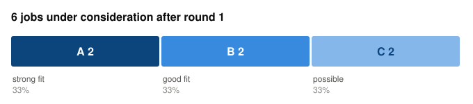

# Saved jobs re-screen - round 1 (2026-11-10)

8 saved jobs, each read in full (8 new this round; the rest keep their earlier review). Calibration questions at the end may still adjust scores.

**Score** = fit from the full-text review (0-100) + adjustments from confirmed rules (domain 60/40, travel sliding scale, ...) + 8 for a 1st-degree connection. The breakdown is shown as fit / adjustments / network.

## Applications: from qualified target to offer

Picks up where the search funnel ends. A job counts at every stage it has reached; a rejection after applying counts as a response. What to do next for each job is in [apply-queue.md](apply-queue.md).

| Stage | Jobs | Of the stage before |
|---|---|---|
| Qualified targets | 6 |  |
| Kit built | 0 | 0% |
| Applied | 0 | - |
| Employer response | 0 | - |
| Interview | 0 | - |
| Offer | 0 | - |

## Ranked list

| # | Score | Tier | Role | Company | Where | Pay (as posted) | 1st-degree |
|---|---|---|---|---|---|---|---|
| 1 | 90 (80 +2 +8 net) | A | [Senior Product Manager, Shipment Visibility](https://example.com/jobs/9100000001) | Harborline Logistics | Remote - United States (Remote) | $155K-$185K | Sam Ortiz (fictional) |
| 2 | 88 (82 +6) | A | [Staff Product Manager, Carrier Integrations API](https://example.com/jobs/9100000002) | Cobalt Route | Remote - Denver, CO (Remote) | $170K-$200K |  |
| 3 | 70 | B | [Senior Product Manager, Inventory Planning](https://example.com/jobs/9100000008) | Pinecrest Health Supply | Remote - United States (Remote) | $145K-$170K |  |
| 4 | 68 (74 -6) | B | [Principal Product Manager, Warehouse Automation](https://example.com/jobs/9100000003) | Brightdock | Hybrid - Decatur, IL (Hybrid) (~37 mi) | $150K-$175K |  |
| 5 | 54 (62 -8) | C | [Senior Product Manager, Checkout and Delivery Options](https://example.com/jobs/9100000006) | Lumen Cart | Remote - United States (Remote) | $160K-$190K |  |
| 6 | 52 (60 -8) | C | [Product Manager, Logistics Data Platform](https://example.com/jobs/9100000005) | Tessellate Systems | Remote - United States (Remote) | not listed |  |
| 7 | 70 | X | [Senior Product Manager, Returns](https://example.com/jobs/9100000004) | Meridian Parcel | Hybrid - Chicago, IL (Hybrid) (~179 mi) | $140K-$165K |  |
| 8 | - | X | [Product Manager, Logistics Software](https://example.com/jobs/9100000007) | Ironbridge Defense Systems | Remote - United States (Remote) | not listed |  |

## Your 1st-degree connections at these companies

- **Sam Ortiz (fictional)** (Director of Engineering at Harborline Logistics) - Harborline Logistics, *Senior Product Manager, Shipment Visibility*

## Job-by-job: looks good, but...

### A - strong fit

#### Harborline Logistics - Senior Product Manager, Shipment Visibility (90)

Shipment-visibility platform: the candidate's core domain, including ETA prediction with data science.

*Adjustments:* core domain (+6); travel 10% (-4)

**Looks good:** Core domain: tracking, ETA and exception alerts / APIs and webhooks match the carrier-integration program / 1st-degree connection (fictional)

**But:** Travel up to 10%

*Skill gaps:* Machine-learning product depth (nice to have; partial)

[Posting](https://example.com/jobs/9100000001)

#### Cobalt Route - Staff Product Manager, Carrier Integrations API (88)

Public carrier API and certification program at a carrier network; a near-exact match for the carrier-integration program.

*Adjustments:* core domain (+6)

**Looks good:** Carrier API, SDKs and certification: done before at scale / API pricing and packaging (nice to have) is a strength

**But:** Staff level: ask about scope and how the role is leveled

[Posting](https://example.com/jobs/9100000002)

### B - good fit

#### Pinecrest Health Supply - Senior Product Manager, Inventory Planning (70)

Demand forecasting and replenishment for a medical supply distributor.

**Eligibility / regulated requirements (beyond your baseline in spec.json):** background check and drug screening (person): "This role requires a background check and drug screening."

**Looks good:** Forecasting with data science matches the ETA-model work

**But:** Healthcare is a new domain

*Skill gaps:* Inventory planning software (required; partial)

[Posting](https://example.com/jobs/9100000008)

#### Brightdock - Principal Product Manager, Warehouse Automation (68)

Warehouse execution system for robotic picking; hybrid in Decatur, inside the radius.

*Adjustments:* travel 15% (-6)

**Looks good:** WMS integrations match the Parcelwise years / Local hybrid, 2 days a week

**But:** Travel up to 15% to customer sites / Robotics hardware is new territory

*Skill gaps:* Robotics or automation hardware (nice to have; missing)

[Posting](https://example.com/jobs/9100000003)

### C - possible

#### Lumen Cart - Senior Product Manager, Checkout and Delivery Options (54)

Delivery options inside a consumer shopping app.

*Adjustments:* consumer scope (-8)

**Looks good:** Last-mile logistics (nice to have)

**But:** Consumer app scope / Growth-metrics track record required

*Skill gaps:* Consumer experimentation at scale (required; partial)

[Posting](https://example.com/jobs/9100000006)

#### Tessellate Systems - Product Manager, Logistics Data Platform (52)

Data platform for supply-chain analytics teams.

*Adjustments:* data-platform company (-8)

**Looks good:** Supply-chain domain (nice to have)

**But:** Sells the data stack itself / Hands-on dbt required

*Skill gaps:* dbt (required; missing), Data warehouse product experience (required; missing)

[Posting](https://example.com/jobs/9100000005)

### Excluded (dealbreaker)

#### Meridian Parcel - Senior Product Manager, Returns (70)

Returns product; hybrid 3 days a week in Chicago.

**Dealbreaker:** Hybrid in Chicago, about 185 miles from Springfield

**Looks good:** Returns workflow experience from Parcelwise

[Posting](https://example.com/jobs/9100000004)

#### Ironbridge Defense Systems - Product Manager, Logistics Software (-)

Supply tracking for defense programs.

**Eligibility / regulated requirements (beyond your baseline in spec.json):** active security clearance (person): "Active security clearance"

**Dealbreaker:** Defense programs (and a required security clearance)

[Posting](https://example.com/jobs/9100000007)

## Leads from 'More jobs' (not preference evidence)

LinkedIn's similar-job suggestions printed with your saved jobs. Listed for discovery only; blocklisted companies removed. 'Connections' means 1st-degree connections work there. **Find** opens a LinkedIn job search for that role (the printed page doesn't include a direct link); **Appeared on** links the saved jobs it was printed next to.

1 leads hidden because they are hybrid or on-site outside the allowed area (remote anywhere; hybrid/on-site within 50 miles of Springfield, IL).

### At companies where you have connections

| Role | Company | Location | Connections | Find | Appeared on |
|---|---|---|---|---|---|
| Product Manager, Carrier Network | Harborline Logistics | United States (Remote) | 1 connection works here | [Find](https://www.linkedin.com/jobs/search/?keywords=Product%20Manager%2C%20Carrier%20Network%20Harborline%20Logistics) | [Harborline Logistics](https://example.com/jobs/9100000001) |

### Most frequently suggested

| Role | Company | Location | Pay | Find | Appeared on |
|---|---|---|---|---|---|
| Senior Product Manager, Tracking API | Ferrous Freight Tech | United States (Remote) |  | [Find](https://www.linkedin.com/jobs/search/?keywords=Senior%20Product%20Manager%2C%20Tracking%20API%20Ferrous%20Freight%20Tech) | [Cobalt Route](https://example.com/jobs/9100000002), [Harborline Logistics](https://example.com/jobs/9100000001) |
| Product Manager, Carrier Network | Harborline Logistics | United States (Remote) |  | [Find](https://www.linkedin.com/jobs/search/?keywords=Product%20Manager%2C%20Carrier%20Network%20Harborline%20Logistics) | [Harborline Logistics](https://example.com/jobs/9100000001) |

## Skills gap (running tally)

Requirements from every reviewed job, matched to the profile and weighted by how often and how strongly top jobs ask (sample).

| Skill | Status | Weight | DQ demand | Seen in | Suggested action |
|---|---|---|---|---|---|
| Machine-learning products | Partial | 2 | 0 | Harborline Logistics, Pinecrest Health Supply | Describe the ETA model as a product decision, not a data-science project. |
| Usage-based pricing | Have - not on resume | 2 | 0 | Harborline Logistics, Arcadia Fleet | Add the 22% new-revenue result to the resume. |
| dbt | Missing | 1 | 1 | Tessellate Systems, Kestrel Analytics (DQ) | Low priority: only data-platform roles ask for it. |
| Telematics / IoT devices | Missing | 1 | 0 | Arcadia Fleet | A short course would cover the vocabulary. |
| Carrier / partner API programs | Have | 4 | 0 | Cobalt Route, Arcadia Fleet, Harborline Logistics | Lead with it. |

## Resume & LinkedIn update candidates

Skills you have that the resume or LinkedIn doesn't show yet. The optional end-of-round review turns these into tracked changes and paste-ready LinkedIn text.

- **Usage-based pricing** (weight 2, DQ demand 0): Add the 22% new-revenue result to the resume.

## Training tracks

Skill gaps grouped by the kind of role that requires or prefers them. Demand counts saved jobs (weight) and jobs DQ'd for a missing skill (DQ demand).

### Fleet and telematics platforms

*For:* fleet-platform PM roles

- **Telematics / IoT devices**: Missing; weight 1, DQ demand 0
- **Carrier / partner API programs**: Have; weight 4, DQ demand 0

*Steps:*
1. Read two telematics data-standard overviews
2. Map the carrier API work to device data flows

## Calibration questions - round 1

1. **Core domain:** Should shipment visibility and carrier integrations score above other logistics roles?
2. **Defense:** Ironbridge builds logistics software for defense programs. Rule it out?
3. **Travel:** Brightdock asks for up to 15% travel. Where's your limit?
4. **Company type:** Tessellate sells a data platform; Lumen Cart is a consumer app. Penalty or dealbreaker?
